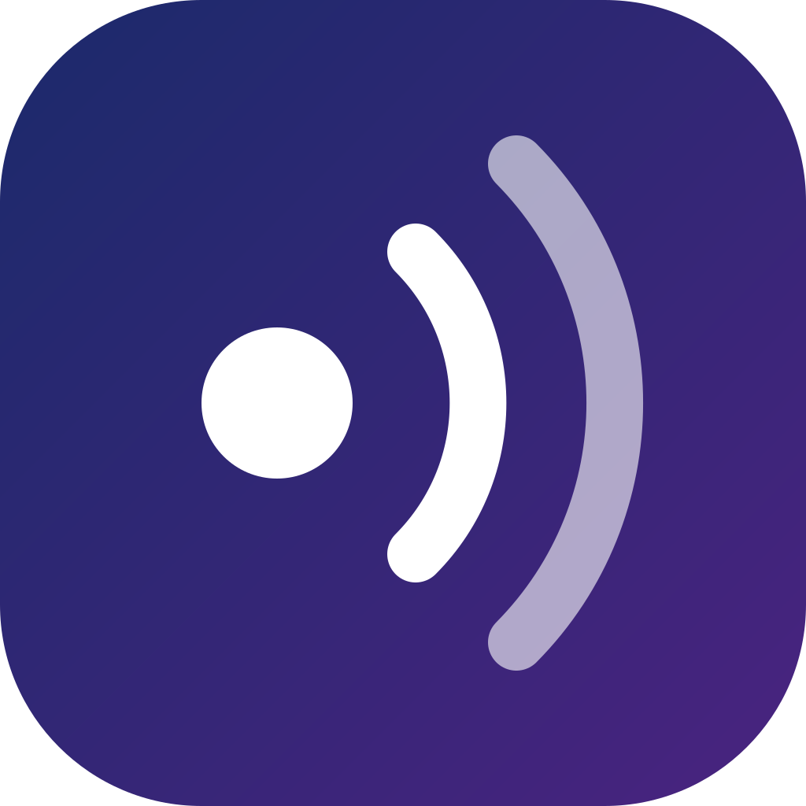

  

<h1 align="center">Echoport</h1>

  میکروفون و بلندگوی دستگاه‌هایتان را از طریق شبکهٔ محلی به اشتراک بگذارید. 
  رایگان، متن‌باز، بدون حساب کاربری و بدون محدودیت زمانی.

  <a href="README.md">English</a> · <b>فارسی</b>

---

## چه کاری انجام می‌دهد؟

هر دستگاهی که Echoport روی آن نصب است دو نقش دارد:

- **سرور**: صدا را می‌فرستد؛ یا صدای **میکروفون** یا **صدایی که دستگاه پخش می‌کند**.
- **پلیر**: صدا را دریافت می‌کند و در **بلندگو** یا یک **میکروفون مجازی** پخش می‌کند.

مثلاً می‌توانید گوشی را میکروفون بی‌سیم کامپیوتر کنید (برای دیسکورد، زوم یا OBS)، یا صدای کامپیوتر را با هدفونِ وصل به گوشی بشنوید.

## امکانات

- اتصال از طریق Wi-Fi یا USB تترینگ، و پیدا شدن خودکار دستگاه‌ها
- اتصال با کد QR یا آدرس IP؛ همهٔ آدرس‌های شبکهٔ سرور نمایش داده می‌شود
- تقویت صدای میکروفون تا ۴۰۰٪، حذف نویز و اکولایزر
- بافر قابل تنظیم برای تعادل بین تأخیر و پایداری
- PIN اختیاری برای اتصال امن
- ضبط صدای دریافتی در فایل WAV
- اتصال چند پلیر هم‌زمان به یک سرور
- ۱۴ تم روشن و تیره که به‌طور پیش‌فرض از حالت سیستم پیروی می‌کند
- پشتیبانی کامل از فارسی و چیدمان راست‌به‌چپ
- اجرای خودکار با ویندوز و فعال ماندن در System tray

## نصب

آخرین نسخهٔ نصب‌کنندهٔ ویندوز و فایل APK اندروید را از بخش
[Releases](https://github.com/HKaaf/echoport/releases) دانلود کنید.

- **ویندوز:** نصب‌کننده هنوز امضای دیجیتال ندارد و ممکن است SmartScreen هشدار بدهد؛ روی
  *More info ← Run anyway* بزنید. برای میکروفون مجازی، درایور رایگان
  [VB-Cable](https://vb-audio.com/Cable/) را یک بار نصب کنید.
- **اندروید:** روی گوشی‌های شیائومی، ردمی و سامسونگ، در تنظیمات Echoport گزینهٔ
  «اجازهٔ اجرا در پس‌زمینه» را بزنید تا صدا قطع نشود.

## لایسنس

[GPL-3.0-or-later](LICENSE)

